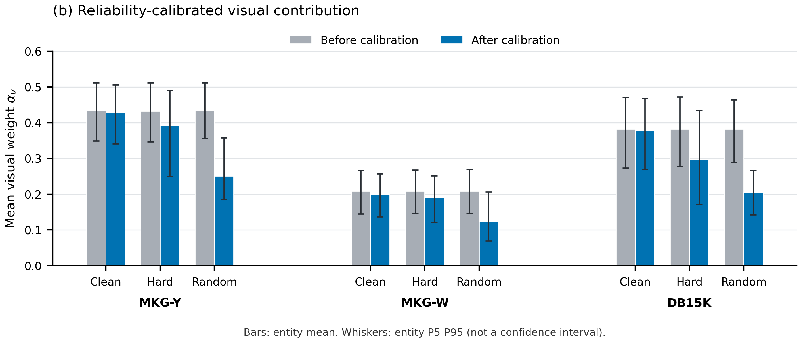

# PSR results verification package

This package verifies frozen result files and supports redrawing Figure 2(b).
It does not reproduce model training, model inference or KGC ranking.
It contains no PSR model implementation, checkpoint, raw benchmark or feature tensor.

## Verify locally

Run `python verify_results.py`. This standard-library check validates every listed
file hash, parses CSVs and inspects the NPZ numeric array headers without loading
Python objects. It does not access a server or start model computation.

To redraw the separate Figure 2(b) panel, install NumPy and Matplotlib in your
own environment and run `python replot_figure2b.py --output figure2b_redrawn`.
The plotting script reads only the supplied statistics; it performs no model
forward and does not replace the paper's original figure.

## Statistical scope

Main controlled results use the frozen final Random mapping, not historical
random endpoints. Main training-seed standard deviations are sample SDs.
Figure 2(b) uses seed 42, eta 0.30, one observation per entity per condition,
population SD and entity P5/P50/P95. The whiskers are entity P5-P95, not
standard errors, confidence intervals or three-seed variability.

MMpedia endpoint metrics, summary, mechanism and bootstrap CSVs are kept
separate. Bootstrap samples test triples with head/tail directions paired;
the interval describes query uncertainty, not training-seed significance.
31.4% is the reduction of noise-induced MRR degradation relative to the
LBMKGC baseline, not a 31.4% rise in MRR. Source citations and permissions for
third-party materials must be retained.

## Release status

This repository contains the author-approved results-verification release.
It is not a release of the PSR model implementation or checkpoints. A curated
code and shareable reproducibility release is planned upon acceptance.
Third-party datasets and features must be obtained from their original sources;
no blanket license is assigned to third-party assets.

